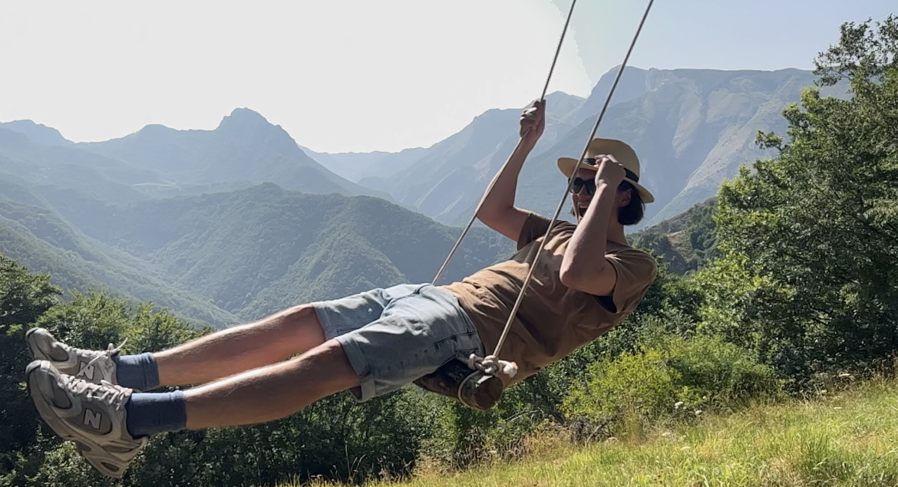

::: hero
::: hero-text
[Psychology · Statistics · Data Science]{.hero-eyebrow}

# Hi, I'm Oliver. I turn data into *insight.*

::: hero-lead
Willkommen auf meiner Webseite! Hier findest du mehr Infos über mich, Beschreibungen meiner bisherigen Projekte und mein persönliches Wiki zu Statistik, Linearer Algebra und Python.
:::

::: hero-actions
[See projects <i class="bi bi-arrow-right"></i>](projects.qmd){.btn-oz}
[<i class="bi bi-envelope"></i> Email me](mailto:oliver9402@gmail.com){.btn-oz-ghost}
:::
:::

::: hero-photo
{fig-alt="Oliver on a rope swing in front of a mountain valley"}
:::
:::

::: section-head
## Selected projects

[All projects →](projects.qmd)
:::

::: {#featured}
:::

::: section-head
## Personal wiki

[Open the wiki →](wiki.qmd)
:::

::: section-sub
Notes I keep while learning — written for my future self, shared in case they help someone else.
:::

::: topic-grid
::: topic-card
<i class="bi bi-bar-chart-line"></i>

[Statistics](wiki/Statistics/stats_start.qmd){.stretched-link}

[GLMs, model diagnostics, longitudinal data, graph neural networks]{.topic-desc}
:::

::: topic-card
<i class="bi bi-grid-3x3"></i>

[Linear Algebra](wiki/LinAlg/linalg_start.qmd){.stretched-link}

[Linear systems, bases, linear maps, eigenvalues, orthonormal bases]{.topic-desc}
:::

::: topic-card
<i class="bi bi-filetype-py"></i>

[Python](wiki/Python/python_start.qmd){.stretched-link}

[Basics, retrieval augmented generation, LLMs and git]{.topic-desc}
:::

::: topic-card
<i class="bi bi-database"></i>

[SQL](wiki/SQL/start.qmd){.stretched-link}

[Logical execution order and exercises]{.topic-desc}
:::
:::
